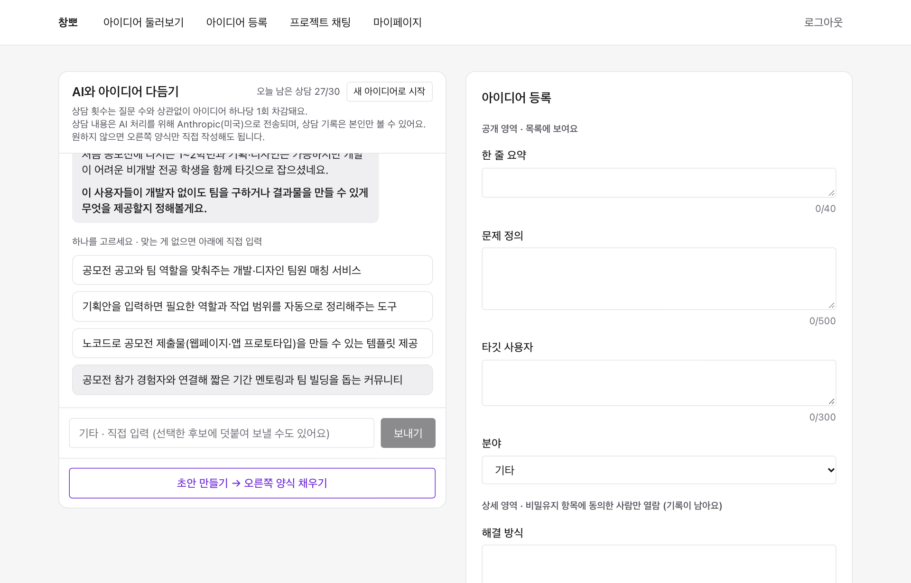
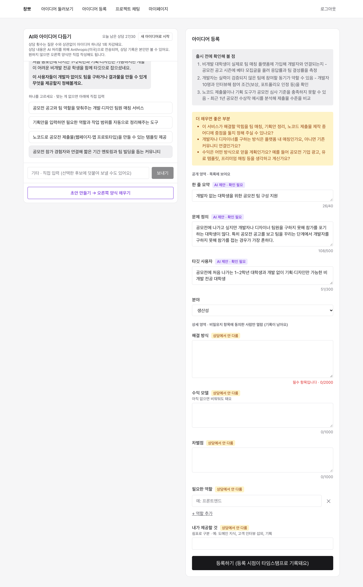
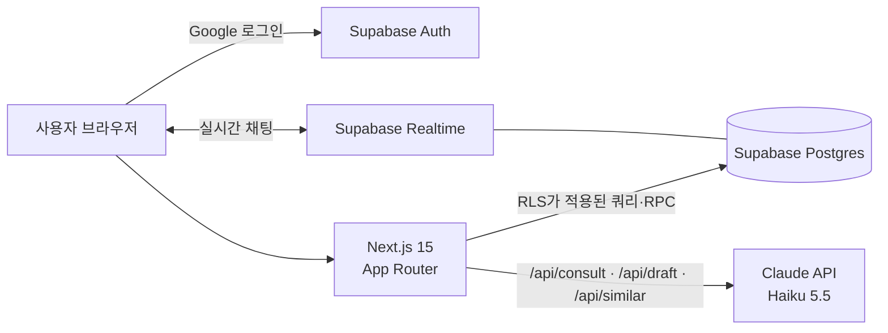

<div align="center">

# 창뽀 · chang-bbo

**창업 아이디어를 올리면, 공감한 사람들이 팀으로 합류해 실제로 만들기까지.**

아이디어는 있는데 만들 사람이 없는 사람과, 만들 수는 있는데 아이디어가 없는 사람을 잇는 팀 빌딩 플랫폼입니다.<br>
AI가 아이디어를 함께 다듬고, 비밀유지 동의와 기록으로 아이디어를 안심하고 공개할 수 있게 합니다.


<picture>
  <source media="(prefers-color-scheme: dark)" srcset="docs/screenshots/02-ideas-dark.png">
  
</picture>

</div>

> 스크린샷은 모두 데모 데이터로 찍었습니다. GitHub 테마(라이트/다크)에 맞는 화면이 표시돼요.

---

## 왜 만들었나요

| 이런 사람이 있어요 | 그런데 |
|---|---|
| 💡 창업 아이디어는 있는데 개발할 사람·시간이 없는 사람 | 아이디어가 아이디어로만 끝나요 |
| 🛠️ 캡스톤·포트폴리오·사이드 프로젝트 주제가 필요한 개발자·디자이너 | 무엇을 만들지 정하는 단계에서 막혀요 |
| 🤝 두 사람이 만나더라도 | "공개하면 아이디어만 가져가지 않을까?" 하는 불안 때문에 아이디어를 꺼내지 못해요 |

창뽀는 **"훔치면 손해가 크고, 같이 하는 게 더 이득인 구조"**를 목표로 합니다.

## 주요 기능

### 1. AI와 아이디어 다듬기 → 등록 양식 자동 작성
아이디어를 한두 문장만 입력하면, AI가 문제 정의·타깃·해결 방식·수익 모델·차별점·필요한 역할을 하나씩 물어봅니다.
매 질문마다 **아이디어에 맞춘 답변 후보 3~4개**를 보여줘서 클릭만으로 답할 수 있고, 맞는 게 없으면 직접 입력하면 됩니다.

<picture>
  <source media="(prefers-color-scheme: dark)" srcset="docs/screenshots/03-ai-consult-dark.png">
  
</picture>

상담이 끝나면 **[초안 만들기]** 한 번으로 등록 양식이 채워집니다.
AI 후보에서 고른 내용은 `AI 제안` 배지로 구분되고, 출시 전에 검증할 가정 3가지와 더 채우면 좋은 부분도 알려줍니다.

<details>
<summary>초안이 채워진 등록 양식 보기</summary>

<picture>
  <source media="(prefers-color-scheme: dark)" srcset="docs/screenshots/04-draft-dark.png">
  
</picture>
</details>

### 2. 비슷한 아이디어 안내 (막지 않고 기록)
등록 전에 비슷한 아이디어가 있는지 확인합니다. 다른 사람의 것이라면 **그 팀에 합류 지원**하거나 **차별점을 보완**하거나 **그래도 등록**할 수 있어요.
비교에는 누구나 볼 수 있는 공개 영역만 쓰고, 안내받은 사실은 분쟁 대비 기록으로 남습니다.

<picture>
  <source media="(prefers-color-scheme: dark)" srcset="docs/screenshots/05-similar-dark.png">
  
</picture>

### 3. 공개 영역 / 상세 영역 + 항목별 비밀유지 동의
제목·문제 정의·타깃은 누구나 볼 수 있고, **해결 방식·수익 모델·차별점은 비밀유지 항목 7개에 모두 동의해야** 바로 열람할 수 있습니다.
좋아요와 댓글로 아이디어에 의견을 남기고, 마음에 들면 원하는 역할로 팀 합류를 지원합니다.

<picture>
  <source media="(prefers-color-scheme: dark)" srcset="docs/screenshots/06-detail-dark.png">
  
</picture>

### 4. 마이페이지 — 누가 언제 동의하고 열람했는지
작성자는 **비밀유지 동의 기록**(누가, 언제, 어떤 버전의 동의서에)과 **상세 열람 기록**을 확인하고, 받은 지원을 수락해 팀을 만듭니다.

<picture>
  <source media="(prefers-color-scheme: dark)" srcset="docs/screenshots/07-mypage-dark.png">
  
</picture>

### 5. 프로젝트 채팅 + 주간 체크인
팀이 만들어지면 실시간 채팅방이 열립니다. 매주 "진행 중 / 막힘 / 중단"을 기록해 **결성 후에도 개발이 이어지는지** 확인할 수 있어요.

<picture>
  <source media="(prefers-color-scheme: dark)" srcset="docs/screenshots/08-chat-dark.png">
  
</picture>

<details>
<summary>로그인 화면 보기</summary>

구글 계정으로 바로 시작합니다. 학교 메일 계정으로 로그인하면 프로필과 댓글에 `○○대학교 인증`이 표시됩니다.

<picture>
  <source media="(prefers-color-scheme: dark)" srcset="docs/screenshots/01-login-dark.png">
  
</picture>
</details>

## 구현 예정: 창업 온보딩

> 🚧 아래 기능은 **설계 단계**이며 아직 구현되지 않았습니다.

창뽀는 사이드 프로젝트 매칭이 아니라 **창업을 위한 프로그램**을 목표로 합니다.
팀이 결성되면 프로젝트 페이지에서 **단계형 창업 온보딩**이 열리고, 팀이 함께 채우는 워크북을 따라 문제 정의부터 피치덱까지 진행합니다.
각 단계는 아이디어 등록 때와 같은 방식(AI 질문 + 클릭으로 고르는 답변 후보)으로 진행합니다.

| 단계 | 하는 일 | 앱에서의 형태 |
|---|---|---|
| **0. 팀 합의** | 역할, 주당 투입 시간, 의사결정 방식, 그만둘 때의 규칙 | 팀원 모두가 서명하는 합의서. 해시 체인으로 기록 |
| **1. 문제 정의 다시 쓰기** | 아이디어 제공자의 문제 정의를 팀 전체가 다시 검토 | "누가, 언제, 왜 불편한가" 틀로 다시 작성. AI가 모호한 표현을 지적 |
| **2. 고객 인터뷰** | 실제 고객 5~10명 인터뷰 | 질문지 생성(유도 질문 걸러냄), 인터뷰 기록 카드, 가정별 "맞음/틀림" 집계 |
| **3. 시장조사** | 시장 규모, 경쟁사, 대체재 | TAM/SAM/SOM 계산 도우미, 경쟁사 비교표, 출처 링크 필수 |
| **4. 수익모델** | 누가 돈을 내는지, 가격, 비용 구조 | 린 캔버스, 고객 1명당 수익·비용 계산기 |
| **5. 동업 구조** | 지분 나누기, 베스팅, 기여 기록 | 지분 배분 시뮬레이터, 베스팅 일정 예시, 동업계약서 체크리스트 |
| **6. MVP와 검증 계획** | 가장 작은 실험 정하기 | 실험 카드(가설 → 실험 → 성공 기준 → 결과), 주간 체크인과 연결 |
| **7. 피치덱 / IR 자료** | 10~12장짜리 피치덱 | 0~6단계 결과로 장표 초안 자동 생성. 근거가 없는 장표는 "근거 부족"으로 표시 |

**기존 기능과의 연결**
- 아이디어 초안의 **검증할 가정 3가지**가 2단계 인터뷰와 6단계 실험의 출발점이 됩니다.
- **주간 체크인**에 현재 단계를 함께 기록해 팀의 진척도를 보여줍니다.
- 0단계 합의서와 5단계 지분 합의는 **해시 체인과 기록**으로 남겨, 아이디어 보호에서 나아가 동업 분쟁 예방까지 다룹니다.
- 피치덱의 각 문장은 근거가 된 인터뷰·실험과 연결되고, 외부에 보낼 때 **비밀 영역을 얼마나 넣을지** 팀이 고릅니다.
- 아이디어 목록에 "고객 인터뷰 완료", "MVP 검증 중" 같은 **진행 배지**를 표시합니다.

**이용 방식: 프로젝트별 팀 결제로 해금**

온보딩은 사람이 아니라 **프로젝트(팀) 단위**로 열립니다. 결과물(합의서, 인터뷰, 피치덱)이 모두 팀의 것이기 때문입니다.

| 구간 | 이용 조건 |
|---|---|
| **0~1단계** (팀 합의, 문제 정의) | 무료. 결제 전에 온보딩이 어떤 건지 먼저 경험 |
| **2~7단계** (고객 인터뷰 ~ 피치덱) | 팀이 비용을 나눠 내면 해당 프로젝트에서 해금 |

결제 흐름:
1. 팀원 한 명이 결제를 시작하면 **팀원 수만큼 몫이 나뉩니다.**
2. 각자 자기 몫을 결제합니다. 누가 냈는지 팀 화면에 표시됩니다.
3. **전원이 결제하면 바로 해금**됩니다.
4. **7일 안에 다 모이지 않으면 낸 금액은 자동 환불**됩니다.

이렇게 하는 이유:
- 돈을 함께 낸 팀은 결성 후 흐지부지될 가능성이 낮습니다. 창뽀가 보려는 "결성 후에도 이어지는가"와 같은 목표입니다.
- 나눠 내면 1인당 부담이 작습니다.
- 온보딩은 AI 호출이 많아, 결제로 AI 비용을 감당합니다.

정해야 할 것:
- 가격, 해금 후 팀원이 바뀌었을 때(합류·탈퇴) 몫 처리 방식
- 실제 결제는 PG(토스페이먼츠, 포트원 등) 계약에 필요한 **사업자등록 후** 가능합니다. 그 전에는 테스트 모드로 흐름만 구현합니다.

나중에 추가할 결제 방법: **학교 이용권**. 대학 창업지원단이 이용권을 사서 학생 팀에 나눠주는 방식으로, 기존 학교 메일 인증과 연결합니다.

**구현 순서**
1. 0~2단계(팀 합의, 문제 정의, 고객 인터뷰)와 진행 표시
2. 팀 나눠 내기 결제(테스트 모드)와 2단계 이후 해금
3. 3~6단계(시장조사, 수익모델, 동업 구조, MVP 검증)
4. 7단계 피치덱 자동 생성

> ⚠️ 동업 구조·지분 관련 내용은 교육용 안내이며, 실제 계약 전에는 법률 자문이 필요합니다.

## 아이디어 보호 장치

아이디어를 본 사람이 내용을 잊게 만들 수는 없으므로, 기술적으로 완전히 막는 것은 불가능합니다.
대신 **도용하면 기록이 남고, 같이 하는 편이 더 이득이 되도록** 설계했습니다.

| 장치 | 동작 |
|---|---|
| 🔐 **단계적 공개** | 공개 영역만 목록에 노출. 상세 영역은 비밀유지 7개 항목에 모두 동의해야 열람 |
| 🧾 **동의·열람 기록** | 동의 시각·동의서 버전·열람 시각을 기록하고 작성자가 확인. 기록은 수정·삭제 불가 |
| ⛓️ **선행 증거 (해시 체인)** | 등록·수정할 때마다 버전별 `SHA-256(이전 해시 + 내용)`을 남겨 "누가 언제 무엇을 올렸는지" 증명 |
| 🤖 **AI 제안 구분** | 사용자가 쓴 내용과 AI 후보에서 고른 내용을 구분해 기록 (AI가 여러 사람에게 비슷한 제안을 했을 때의 분쟁 대비) |
| 🔎 **비슷한 아이디어 안내 기록** | 등록 전에 무엇을 안내받았고 무엇을 골랐는지 기록 |
| 🙋 **제공자도 팀의 일원** | 등록할 때 "내가 제공할 것"(도메인 지식, 고객 섭외 등)을 받아 아이디어만 던지는 구조를 피함 |

> ⚠️ 비밀유지 동의 문구는 **법률 검토 전 초안**입니다. 실제 서비스 전에 법률 자문을 받아야 합니다.

## 기술 스택과 구조



| 영역 | 사용 기술 |
|---|---|
| 프론트엔드 | Next.js 15 (App Router, Server Actions), React 19, Tailwind CSS v4, react-hook-form + Zod |
| 백엔드 / DB | Supabase (Postgres, Auth, Realtime), Row Level Security, `pg_trgm`, `pgcrypto` |
| AI | Claude API (`claude-haiku-5-5`) — 구조화 출력(Zod)으로 상담 질문·후보, 등록 초안, 유사도 판단 |
| 개발 환경 | Docker Compose, Makefile, Supabase CLI |

**설계 원칙**
- **권한은 DB에서 강제**합니다. 상세 영역은 `get_idea_detail()` 함수로만 읽을 수 있고, 이 함수가 권한 확인과 열람 기록을 함께 처리합니다.
- **양식 정의는 한 곳**(`src/lib/idea-schema.ts`)에 두고 AI 구조화 출력·폼 검증·서버 검증이 함께 씁니다.
- **AI에는 다른 사람의 상세 영역을 보내지 않습니다.** 비슷한 아이디어 비교도 공개 영역만 사용합니다.
- AI 상담 기록은 클라이언트가 보낸 것을 믿지 않고 DB에서 다시 읽어 모델에 보냅니다.

## 로컬에서 실행하기

필요한 것: **Docker Desktop**, **Node.js 24**, **make**

```bash
git clone https://github.com/duckgii/chang-bbo.git
cd chang-bbo
make        # 설치 → 로컬 Supabase 시작 → .env.local 자동 설정 → 앱 빌드·실행
```

| 주소 | 용도 |
|---|---|
| http://localhost:3000 | 앱 |
| http://localhost:54323 | Supabase 관리 화면 (Studio) |
| http://localhost:54324 | 로컬 메일함 (개발용 코드 로그인) |

### 환경 변수 (`.env.local`)
`make`가 Supabase 주소와 키는 자동으로 채웁니다. 아래 값은 직접 넣어주세요.

| 이름 | 설명 |
|---|---|
| `ANTHROPIC_API_KEY` | AI 상담용 Claude API 키 (서버 전용) |
| `GOOGLE_CLIENT_ID`, `GOOGLE_CLIENT_SECRET` | Google Cloud Console의 OAuth 클라이언트 (웹 애플리케이션). 승인된 리디렉션 URI: `http://127.0.0.1:54321/auth/v1/callback` |

구글 키를 넣거나 바꾼 뒤에는 `make db-restart`로 반영합니다.
구글 키 없이 써보려면 로그인 화면 아래의 **개발용 이메일 코드 로그인**으로 `아무개@example.ac.kr`에 로그인하고, 코드는 로컬 메일함에서 확인하세요.

### 자주 쓰는 명령

| 명령 | 하는 일 |
|---|---|
| `make` | 전부 켜기 (패키지 설치 단계만 캐시, 코드 빌드는 항상 새로) |
| `make fclean` | 전부 끄고 컨테이너·이미지·볼륨·로컬 DB 데이터 삭제 |
| `make re` | `fclean` 후 캐시 없이 처음부터 |
| `make app` | 앱만 다시 빌드해서 실행 |
| `make db-reset` | DB 초기화 후 마이그레이션 + seed 다시 적용 |
| `make db-migration name=...` | 새 마이그레이션 파일 생성 |
| `make check` | 린트 + 타입 검사 + 빌드 |
| `make help` | 전체 명령 보기 |

## 폴더 구조

```text
src/
├─ app/
│  ├─ ideas/            # 둘러보기 · 상세(동의·좋아요·댓글·지원) · 등록(AI 상담) · 수정
│  ├─ me/               # 마이페이지
│  ├─ projects/         # 프로젝트 채팅 · 주간 체크인
│  ├─ login/, auth/     # 구글 로그인
│  ├─ api/              # consult(AI 상담) · draft(초안) · similar(비슷한 아이디어)
│  └─ actions.ts        # 서버 액션
├─ components/          # 공통 등록 양식, 비슷한 아이디어 안내창
└─ lib/                 # 양식 스키마, AI 프롬프트·클라이언트, Supabase 클라이언트
supabase/
├─ migrations/          # 0001~0008: 스키마, RLS, 해시 체인, 좋아요·댓글, 유사 아이디어, 비밀유지 동의
└─ config.toml          # 로컬 Supabase 설정 (구글 로그인 포함)
```

## 로드맵

- [x] 아이디어 등록(공개/상세 분리)·수정, 버전별 해시 기록
- [x] AI 상담(후보 클릭) → 등록 초안 자동 작성
- [x] 항목별 비밀유지 동의 후 즉시 열람, 동의·열람 기록
- [x] 좋아요·댓글, 팀 합류 지원, 실시간 채팅, 주간 체크인
- [x] 비슷한 아이디어 안내, 구글 로그인, 다크 모드
- [ ] 하루 1회 해시를 외부(GitHub·OpenTimestamps)에 공개해 기록 위·변조 방지 강화
- [ ] 팀 합의서 템플릿 (역할·기여 배분·이탈 시 처리)
- [ ] 신고 처리 관리자 화면, 개인정보처리방침·이용약관
- [ ] 비밀유지 동의서·약관 법률 검토
